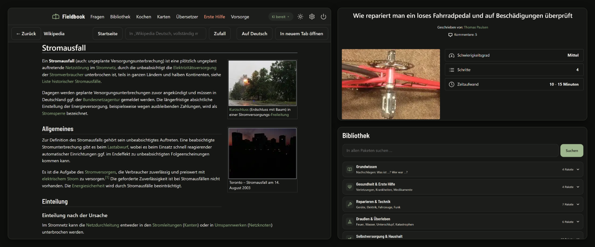
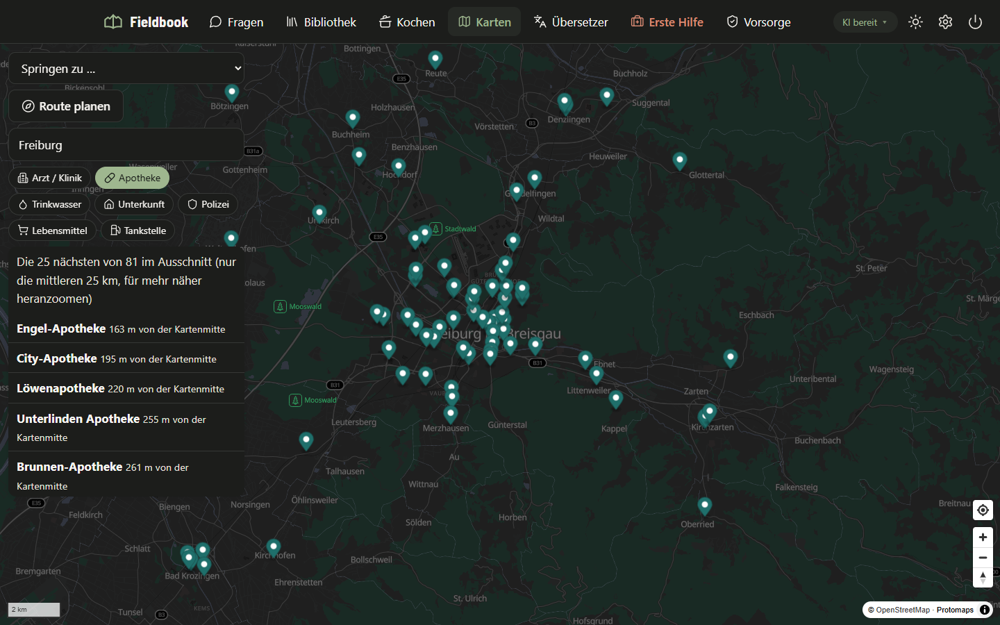
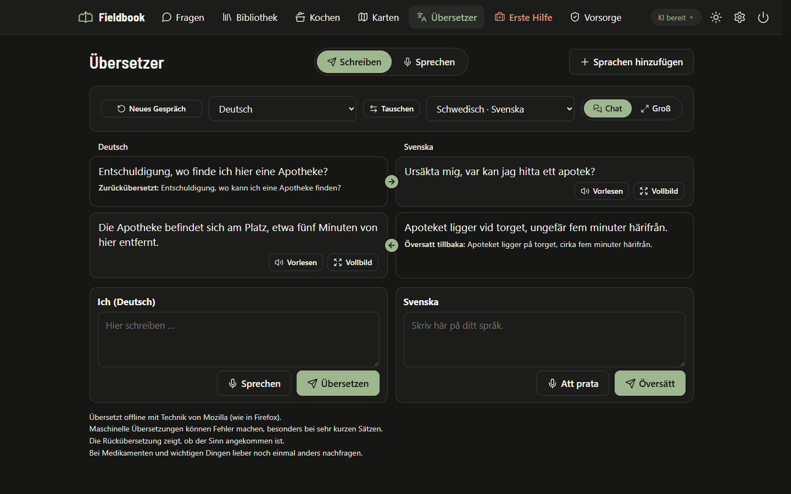
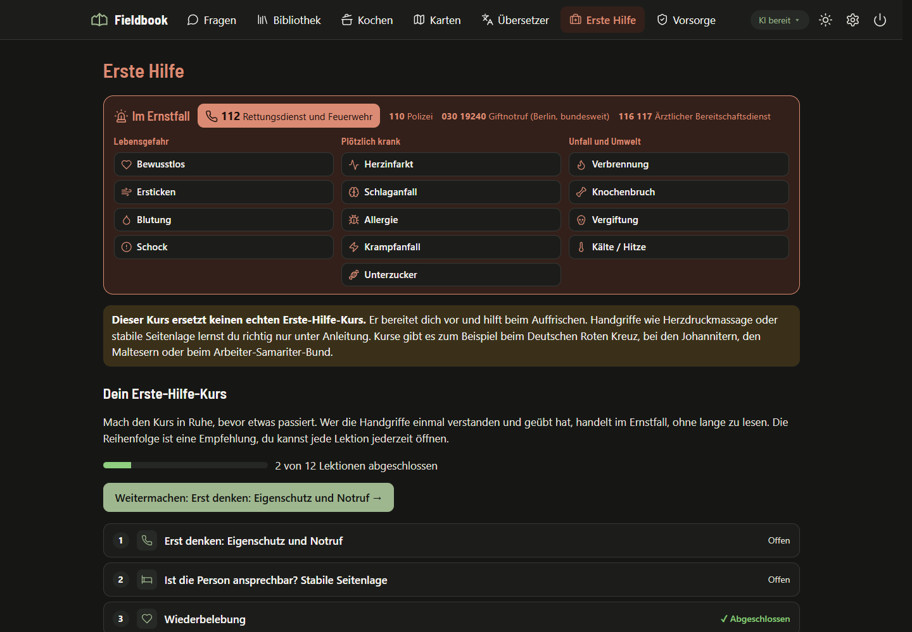

# Fieldbook

**Wissen, wo kein Netz ist**

## Was ist Fieldbook?

Fieldbook holt eine riesige Bibliothek auf deinen Windows-Laptop, die auch ohne Internet funktioniert.\
Darin steckt die komplette deutsche Wikipedia mit allen Bildern, medizinisches Wissen und über 56.000 Reparaturanleitungen von iFixit.\
Dazu kommen Reiseführer, Lehrbücher, ein Kinderlexikon und Klassiker der Literatur.\
Eine KI beantwortet Fragen aus dieser Bibliothek, außerdem gibt es Offline-Karten, einen Übersetzer, einen Erste-Hilfe-Kurs und eine Vorsorge-Checkliste.\
Du lädst einmal herunter, was du brauchst, danach läuft alles offline: beim Stromausfall, auf Reisen oder draußen in der Natur.\
Installieren musst du nichts: entpacken, doppelklicken, fertig.

[](.github/screenshots/bibliothek.png)

### **[Fieldbook 0.8.1 herunterladen](https://github.com/wobix08/Fieldbook/releases/download/v0.8.1/Fieldbook-0.8.1.zip)**

Kostenlos, ohne Konto und ohne Werbung.\
Wie es weitergeht, steht unter [Schnellstart](#schnellstart).

> [!NOTE]
> Fieldbook läuft nur unter **Windows 10 und 11**.\
> Für macOS, Linux, iPhone, iPad und Android gibt es keine Version.

## Was drin ist

| | Bereich | Was es kann |
|---|---|---|
|  | **Bibliothek** | Rund 40 Wissenspakete zum Auswählen, alles im Fieldbook-Design (hell oder dunkel):<br>• Wikipedia auf Deutsch, komplett mit Bildern (49&nbsp;GB), ohne Bilder (19&nbsp;GB) oder kompakt (5&nbsp;GB)<br>• Medizin: Wikipedia-Medizin, MDWiki und Handbücher für Notlagen<br>• Reparieren: über 56.000 Reparaturanleitungen von iFixit (die meisten auf Englisch, Fieldbook übersetzt sie auf Knopfdruck ins Deutsche)<br>• Draußen und Selbstversorgung: Wasser aufbereiten, Knoten, Einkochen, Gärtnern, Energie ohne Netz<br>• Wikivoyage (Reiseführer), Wikibooks (Lehrbücher), Klexikon (Kinderlexikon), Project Gutenberg (Literatur) und mehr |
|  | **Fragen** | Eine lokale KI beantwortet Fragen anhand der Offline-Bibliothek, mit Quellenangabe |
|  | **Kochen** | Rezepte zu dem, was du da hast, Rezepte aus dem Vorrat und Faustregeln zu Trinkwasser, Haltbarkeit, Brennstoff sparen und Einkochen |
|  | **Karten** | OpenStreetMap-Karten offline, Länder einzeln laden und nahtlos zusammen ansehen, Ortssuche, Routenplanung, Ärzte, Apotheken und Trinkwasser in der Nähe |
|  | **Übersetzer** | Gespräche in zwei Sprachen: abwechselnd schreiben oder einfach sprechen (Sprechmodus erkennt, wer spricht), offline übersetzt und vorgelesen, 52 Sprachen zum Nachladen |
|  | **Erste&nbsp;Hilfe** | Ein Kurs zum Vorbereiten mit Lektionen, Quiz und Fallbeispielen, dazu Spickzettel für den Ernstfall |
|  | **Vorsorge** | Vorbereiten in drei Stufen (Vorräte, Hausapotheke, Licht, Dokumente …) und was zu tun ist, wenn Strom oder Wasser weg sind |

| Karten | Übersetzer | Erste Hilfe |
|---|---|---|
| [](.github/screenshots/karten.png) | [](.github/screenshots/uebersetzer.png) | [](.github/screenshots/erste-hilfe.png) |

> [!WARNING]
> Der Erste-Hilfe-Kurs folgt gängigen Erste-Hilfe-Regeln, ersetzt aber keinen echten Erste-Hilfe-Kurs und keine ärztliche Hilfe.\
> KI-Antworten können Fehler enthalten.\
> Bei wichtigen Entscheidungen immer die Quellen lesen.

## Inhalt

- [Schnellstart](#schnellstart)
- [Warum Fieldbook?](#warum-fieldbook)
- [Ist das sicher?](#ist-das-sicher)
- [Die KI](#die-ki)
- [Updates](#updates)
- [Datenschutz](#datenschutz)
- [Downloads in Firmen- und Schulnetzen](#downloads-in-firmen--und-schulnetzen)
- [Für Entwickler](#für-entwickler)
- [Lizenz](#lizenz)

## Schnellstart

1. **[Fieldbook 0.8.1 herunterladen](https://github.com/wobix08/Fieldbook/releases/download/v0.8.1/Fieldbook-0.8.1.zip)** (ZIP-Datei, etwa 3 MB) und entpacken, zum Beispiel nach `C:\Fieldbook` oder auf einen USB-Stick.\
   Frühere Versionen und was sich geändert hat, stehen unter [Releases](../../releases).
2. **`Fieldbook.exe`** doppelklicken.
3. Der Einrichtungs-Assistent öffnet sich im Browser.\
   Er erkennt die Hardware, schlägt eine passende KI vor und lädt die gewählten Inhalte herunter.
4. Ab dann funktioniert alles offline.

Eine ausführliche Schritt-für-Schritt-Anleitung steht in der [GUIDE.md](GUIDE.md).

> Windows zeigt beim ersten Start „Der Computer wurde durch Windows geschützt“, weil das Programm neu und nicht signiert ist.\
> Dann auf **Weitere Informationen → Trotzdem ausführen** klicken.\
> Das ist nur einmal nötig.\
> Warum das harmlos ist, steht unter [Ist das sicher?](#ist-das-sicher).

**Systemanforderungen**
- Windows 10 oder 11 (64 Bit), andere Betriebssysteme werden nicht unterstützt
- Mindestens 4 GB Arbeitsspeicher, für die KI 8 GB oder mehr
- Speicherplatz je nach Auswahl: etwa 20 GB („Das Wichtigste“ bei wenig Platz, mit KI) bis über 100 GB (alles)
- Internet nur für die Einrichtung
- Oberfläche auf Deutsch, Notrufnummern für Deutschland, Österreich und die Schweiz

## Warum Fieldbook?

Ich bin gerne gut vorbereitet, ob auf einen Stromausfall, eine Reise ohne Netz oder eine Frage, auf die gerade niemand eine Antwort hat.

Als Technikbegeisterter finde ich außerdem die Idee dahinter einfach großartig: einen gut ausgewählten Teil des Internets, also Wissen, Anleitungen und Karten, auf ein einziges Gerät zu packen, das auch ohne Netz funktioniert.\
Deshalb hat mich [Project NOMAD](https://www.projectnomad.us/) sehr beeindruckt: Wikipedia, Karten, Anleitungen und eine KI, alles auf einem Gerät und ohne Internet.\
Ein richtig gutes Projekt, genau wie [Internet-in-a-Box](https://internet-in-a-box.org/), das mich ebenfalls inspiriert hat.\
Dafür braucht man aber ein eigenes Linux-System, Docker oder eine virtuelle Maschine, und darauf hatte ich keine Lust.\
Ich wollte dieselbe Idee auf einem ganz normalen Windows-Laptop haben: entpacken, doppelklicken, fertig.

Außerdem soll so eine Wissenssammlung nicht nur etwas für Technikbegeisterte sein.\
Jeder, der einen Windows-Laptop hat, soll sie nutzen können, ob im Stromausfall, auf Reisen oder in einer einsamen Hütte im Wald.

Fieldbook habe ich mit Hilfe der KI Claude entwickelt.\
Ideen, Auswahl der Inhalte und alle Entscheidungen stammen von mir.

## Ist das sicher?

Ein unbekanntes Programm aus dem Internet zu starten, erfordert Vertrauen.\
Deshalb ist bei Fieldbook alles offen und überprüfbar:

- **Der komplette Quellcode liegt in diesem Repository**\
  Es gibt keine versteckten Teile.\
  Auch die Startdatei `Fieldbook.exe` wird aus [`tools/Starter.cs`](tools/Starter.cs) gebaut (rund 300 Zeilen).\
  Sie startet `app\Start.bat` und zeigt ein kleines Startfenster, bis Fieldbook im Browser offen ist.
- **Ohne .exe starten**\
  Wer keine .exe starten möchte, kann stattdessen `app\Start.bat` doppelklicken.\
  Das ist eine lesbare Textdatei, genau wie der restliche Programmcode in `app\`.\
  Das hilft auch, wenn ein Virenschutz die .exe blockiert (mehr dazu unter [Downloads in Firmen- und Schulnetzen](#downloads-in-firmen--und-schulnetzen)).
- **Keine Installation, keine Administratorrechte**\
  Fieldbook verändert nichts an Windows und schreibt nur in seinen eigenen Ordner.\
  Einzige Ausnahme: Die *optionale* automatische Aktualisierung legt zwei Aufgaben in der Windows-Aufgabenplanung an.\
  Zum Entfernen genügt es, den Ordner zu löschen.\
  Hast du die automatische Aktualisierung eingeschaltet, schalte sie vorher in den Einstellungen aus, dann verschwinden auch die beiden Aufgaben.
- **Deine Daten bleiben bei dir**\
  Kein Konto, keine Werbung.\
  Alles läuft auf `localhost`, also nur auf deinem Gerät.\
  Fragen an die KI, Chats und alles, was du in Fieldbook einträgst, verlassen dein Gerät nicht.\
  Rückmeldungen, Fehlerberichte und Nutzungsstatistik verschickt Fieldbook nur, wenn du das ausdrücklich willst.\
  Was genau wann übertragen wird, steht unter [Datenschutz](#datenschutz).
- **Downloads nur aus offiziellen Quellen**\
  Alle stehen in [`app/config/programme.json`](app/config/programme.json) und den anderen Konfigurationsdateien:

  | Was | Woher |
  |---|---|
  | Wissenspakete, kiwix-serve | download.kiwix.org (Kiwix / Wikimedia) |
  | KI-Modelle, Modelle für die Spracheingabe, Stimmen zum Vorlesen | huggingface.co |
  | llama.cpp, whisper.cpp, Piper, BRouter, PMTiles, Java (Eclipse Temurin) | github.com (offizielle Releases der Projekte) |
  | Karten | build.protomaps.com (OpenStreetMap-Daten) |
  | Wegedaten | brouter.de |
  | Ortsnamen | download.geonames.org |
  | Übersetzer (Bergamot) | cdn.jsdelivr.net (npm-Paket `@browsermt/bergamot-translator`, feste Version) |
  | Übersetzungsmodelle (Artikel und Gespräche) | firefox.settings.services.mozilla.com und firefox-settings-attachments.cdn.mozilla.net (Mozilla, dieselben Modelle wie in Firefox, Prüfsumme wird nach dem Download kontrolliert) |

- **Prüfsumme**\
  Zu jedem Release gibt es eine Datei `.sha256`.\
  Damit lässt sich prüfen, dass die heruntergeladene ZIP nicht verändert wurde:

  ```powershell
  Get-FileHash .\Fieldbook-0.8.1.zip -Algorithm SHA256
  ```

  Der angezeigte Wert muss mit dem in der `.sha256`-Datei übereinstimmen.
- **Noch nicht signiert**\
  `Fieldbook.exe` hat noch keine digitale Signatur.\
  Kostenlose Signaturen für Open-Source-Projekte gibt es erst, wenn ein Projekt schon bekannter ist.\
  Fieldbook beantragt sie später erneut.\
  Gebaut wird jede Version automatisch auf GitHub aus dem Quellcode dieses Repositorys ([`.github/workflows/release.yml`](.github/workflows/release.yml)).\
  Ob die heruntergeladene Datei unverändert ist, zeigt die Prüfsumme.
- **Selbst prüfen lassen**\
  Wer möchte, lädt die ZIP bei [VirusTotal](https://www.virustotal.com) hoch.\
  Dort prüfen rund 70 Virenscanner gleichzeitig.

## Die KI

Im Moment bietet Fieldbook nur **Qwen 3.5 (4B)** an (2,7 GB Download).\
Es läuft auf jedem Laptop mit 8 GB Arbeitsspeicher, auch ohne Grafikkarte.\
Weitere KIs folgen, sobald sie mit den Testfragen geprüft sind.\
Bei weniger als 8 GB Arbeitsspeicher schlägt der Assistent „Keine KI“ vor.\
Bibliothek, Karten und Erste Hilfe laufen trotzdem.

**So entsteht eine Antwort**

```
Frage ──► KI erzeugt Suchbegriffe ──► Suche in allen Wissenspaketen (Kiwix)
                                            │
Antwort mit Quellen [1] [2] ◄── KI liest die besten Abschnitte
```

Die KI antwortet nur anhand der gefundenen Artikel und nennt die Quellen.\
Englische Quellen (z. B. medizinische Handbücher) übersetzt sie sinngemäß ins Deutsche.\
Auch Pakete aus PDF-Büchern durchsucht sie: Fieldbook liest deren Text nach der Installation einmal im Hintergrund aus.\
Eingescannte Bücher ohne Text bleiben dabei außen vor.\
Die Bücher selbst öffnet ein eigener PDF-Leser, mit markierbarem Text in Fieldbook-Schrift, im dunklen Design und auf Knopfdruck auf Deutsch.\
Im **Sparmodus** ist die KI aus.\
Dann zeigt der Bereich „Fragen“ die passenden Artikel direkt an.

**Suchhilfe**\
Mit der KI kommt eine kleine Suchhilfe (EmbeddingGemma von Google, 330 MB).\
Sie sortiert die gefundenen Artikel nach ihrer Bedeutung statt nur nach gleichen Wörtern, damit die KI passendere Quellen bekommt.\
Sie läuft immer auf dem Prozessor und braucht etwa eine Sekunde pro Frage.

**Grafikkarte**\
Grafikkarten von NVIDIA, AMD und Intel Arc werden über Vulkan genutzt, die KI antwortet damit viel schneller.\
Es ist keine Treiber-Zusatzinstallation wie CUDA nötig.\
Ob die Grafikkarte genutzt wird, lässt sich jederzeit in den Einstellungen oder unter *Inhalte* umschalten.\
Die Liste der KIs steht in [`app/config/modelle.json`](app/config/modelle.json).

## Updates

Fieldbook kann die Inhalte und sich selbst aktuell halten.\
Beides passiert nur, wenn du es willst.

**Inhalte automatisch aktualisieren (optional)**\
Hält Wissenspakete, Karten und Wegedaten aktuell.\
Im Assistenten ganz am Anfang einschaltbar oder später in den Einstellungen unter *Fieldbook und Updates*, standardmäßig aus.\
Es gibt keinen Autostart und kein Programm, das dauerhaft im Hintergrund läuft.\
Stattdessen legt Fieldbook zwei Aufgaben in der Windows-Aufgabenplanung an:

| Aufgabe | Wann | Was |
|---|---|---|
| *Fieldbook Daten pruefen* | einmal pro Woche (Sonntag 19 Uhr oder beim nächsten Einschalten) | ein paar kleine Anfragen, dauert unter einer Sekunde; im Modus „Vorher fragen“ danach ein Fenster mit „Herunterladen“, „Immer automatisch“ und „Später“ |
| *Fieldbook Daten herunterladen* | nur wenn der Computer 10 Minuten unbenutzt am Strom hängt | lädt freigegebene Daten mit niedrigster Priorität; bei Maus, Tastatur oder Akkubetrieb sofort Pause, beim nächsten Leerlauf geht es weiter |

Nicht über getaktete Verbindungen (z. B. Handy-Hotspot).\
Aktualisiert werden Wissenspakete (neue Ausgaben im Kiwix-Katalog), Wegedaten (höchstens monatlich) und Karten (etwa halbjährlich).\
Ausschalten in den Einstellungen entfernt beide Aufgaben wieder.\
Protokoll: `daten\logs\aktualisierung.log`.

**Neue Fieldbook-Versionen**\
Fieldbook spielt nie eine neue Version ein, ohne dass du zugestimmt hast.\
Beim Start fragt es nur kurz bei GitHub nach, ob es eine neue Version gibt, und zeigt dann einen Hinweis (in den Einstellungen ganz oben unter *Fieldbook und Updates*).\
Möchtest du auch diese kurze Anfrage nicht, schaltest du sie dort bei *Beim Start nach neuer Fieldbook-Version fragen* aus.\
Dann sucht Fieldbook nur noch, wenn du selbst auf *Nach Updates suchen* klickst.\
Ist die automatische Aktualisierung eingeschaltet, kann sie neue Versionen mitladen (Haken *Dabei auch neue Fieldbook-Versionen mitladen*).\
Im Modus „Vorher fragen“ fragt Fieldbook dich, im Modus „Automatisch herunterladen“ spielt es die neue Version beim nächsten Start ein.

**Sicher bei Problemen**\
Vor jedem Update sichert Fieldbook den bisherigen Programmteil.\
Lässt sich die neue Version nicht starten, kommt automatisch die alte zurück.\
Deine Inhalte im Ordner `daten` bleiben dabei immer unverändert.

## Datenschutz

Fieldbook läuft auf deinem Gerät.\
Fragen an die KI, Chats und alles, was du in Fieldbook einträgst, bleiben dort und werden nie übertragen.\
Aufnahmen der Spracheingabe werden auf deinem Gerät erkannt und gleich danach gelöscht.

**Wann Fieldbook ins Internet geht**\
Nach der Einrichtung nur in diesen Fällen:
- **Beim Start** fragt es kurz bei GitHub nach, ob es eine neue Version gibt.\
  Heruntergeladen wird sie erst, wenn du dies bestätigst.\
  Auch diese Anfrage kannst du in den Einstellungen abschalten.
- **Neue Inhalte** lädt es, wenn du sie auf der Seite *Inhalte* auswählst.
- **Automatische Aktualisierung**, wenn du sie einschaltest (standardmäßig aus).\
  Mehr dazu unter [Updates](#updates).
- **Links ins Internet** in einem Artikel: Fieldbook fragt die Adresse kurz an, um zu sehen, ob es Internet gibt.\
  Mit Internet zeigt Fieldbook erst das Ziel und öffnet es auf Knopfdruck in einem neuen Tab.\
  Ohne Internet erscheint ein kurzer Hinweis statt einer Fehlerseite.
- **Rückmeldungen**, die du selbst abschickst.
- **Fehlerberichte und Nutzungsstatistik**, aber nur, wenn du zugestimmt hast.

**Rückmeldungen**\
Unter *Einstellungen → Rückmeldung und Datenschutz* kannst du mir selbst schreiben, was gut läuft und was nicht.\
Die Nachricht geht erst raus, wenn du auf *Absenden* klickst.\
Was übertragen wird, steht im Formular unter *Was wird mitgeschickt?*:\
dein Text, auf Wunsch eine Kontaktadresse, die Fieldbook-Version, die Windows-Version, die Größe des Arbeitsspeichers, der Name der eingerichteten KI und, nur mit Haken, die Enden der Logdateien.\
In den Logdateien macht Fieldbook deinen Benutzernamen und deine Ordnerpfade unkenntlich.\
Schreib bitte nichts in den Text, was du nicht teilen möchtest.

**Fehlerberichte und Nutzungsstatistik**\
Beides ist aus, bis du es einschaltest (bei der Einrichtung oder unter *Einstellungen → Rückmeldung und Datenschutz*), und lässt sich dort jederzeit wieder ausschalten.\
Fieldbook fragt einmal danach, beide Haken sind am Anfang aus.\
Solange es aus ist, sammelt Fieldbook auch nichts.\
*Fehlerberichte* enthalten Fehler, die in Fieldbook auftreten (Benutzername und Ordnerpfade unkenntlich gemacht), dein Gerät (Prozessor, Kerne, Arbeitsspeicher, Grafik), die Windows-Version und wie schnell die KI lädt und antwortet.\
Die *Nutzungsstatistik* enthält, wie oft du die einzelnen Bereiche öffnest, welche Wissenspakete und Karten installiert sind (selbst hinzugefügte Pakete nur als „eigenes Paket“) und dein Land.\
Nie dabei sind Fragen, Chats, Suchbegriffe, gelesene Artikel, Orte oder Einträge.\
Fieldbook zählt auf deinem Gerät mit und schickt ein kleines Paket, nie über eine getaktete Verbindung wie einen Handy-Hotspot.\
Das erste geht gleich nach dem Einschalten raus, danach eins pro Woche.\
Das nächste Paket kannst du dir unter *Was wird gesendet?* genau ansehen.\
Statt eines Namens trägt es eine zufällige Kennung, damit ein Gerät nicht doppelt gezählt wird; du kannst sie jederzeit neu würfeln.\
Schaltest du beides aus, löscht Fieldbook alles bisher Gesammelte.

Ganz ehrlich: Ich kann jeden verstehen, der das ausgeschaltet lässt, bei anderen Programmen mache ich es genauso.\
Über jedes Ja würde ich mich trotzdem sehr freuen.\
Fieldbook läuft auf ganz unterschiedlicher Hardware, und ohne solche Rückmeldungen bekomme ich kaum mit, wo es hakt oder zu langsam ist.

**Wohin die Daten gehen**\
Rückmeldungen und Wochenpakete laufen über einen kleinen Dienst bei Cloudflare (`fieldbook-feedback.wobix08.workers.dev`, Quellcode in [`tools/feedback-worker.js`](tools/feedback-worker.js)).\
Cloudflare verarbeitet dabei wie jeder Internetdienst deine IP-Adresse, um die Anfrage zuzustellen ([Datenschutz bei Cloudflare](https://www.cloudflare.com/de-de/privacypolicy/)).\
Der Dienst selbst speichert die IP-Adresse nicht.\
Gegen Missbrauch nimmt er je Absender nur wenige Rückmeldungen pro Stunde an.\
Dafür zählt er nur einen unumkehrbaren Kurzwert, der nach spätestens einer Stunde von selbst gelöscht wird.\
Die Rückmeldung landet als Eintrag in einem privaten GitHub-Repository, das nur der Entwickler sehen kann ([Datenschutz bei GitHub](https://docs.github.com/de/site-policy/privacy-policies/github-general-privacy-statement)).\
Sie wird nicht veröffentlicht, nicht weitergegeben und nur genutzt, um Fieldbook zu verbessern und dir auf Wunsch zu antworten.\
Die Wochenpakete landen in einer Datenbank bei Cloudflare (D1), die nur der Entwickler auswerten kann.\
Ist eine Fehlerart neu, legt der Dienst dafür zusätzlich einen Eintrag im privaten Repository an (nur der Fehlertext, Version, Windows und Gerät).

**Wie lange und wie löschen**\
Rückmeldungen werden gelöscht, sobald sie erledigt sind, spätestens nach zwei Jahren.\
Wochenpakete löscht der Dienst nach einem Jahr von selbst.\
Möchtest du, dass etwas früher gelöscht wird, schreib das in eine Rückmeldung (bei der Statistik mit der Kennung aus *Was wird gesendet?*) oder melde dich über das GitHub-Konto [wobix08](https://github.com/wobix08).

**Ohne Zustimmung**\
Schickst du keine Rückmeldung ab und lässt Fehlerberichte und Nutzungsstatistik aus, wird nichts übertragen.

## Downloads in Firmen- und Schulnetzen

Fieldbook braucht Internet nur zum Herunterladen.\
Sperren ein Werbeblocker (z. B. Pi-hole, AdGuard), eine Firewall oder ein Jugendschutzfilter einzelne Adressen, schlagen Downloads fehl.\
In Firmen blockieren außerdem oft die HTTPS-Prüfung der Firewall oder der Virenschutz.\
Das kann nur die IT freigeben.

- **HTTPS-Prüfung (SSL-Inspection)**\
  Viele Firmen-Firewalls entschlüsseln verschlüsselte Verbindungen, um sie zu prüfen.\
  Dabei werden die großen Downloads von Fieldbook oft abgebrochen oder gesperrt.\
  Dann muss die IT die Adressen aus der Tabelle unten von der HTTPS-Prüfung ausnehmen.
- **Virenschutz und Endpoint-Schutz**\
  Fieldbook ist ein kleines, neues Programm und steht deshalb in keiner Liste bekannter, vertrauenswürdiger Programme.\
  Firmen-Virenschutz blockiert solche unbekannten Programme oft vorsorglich, auch wenn nichts Schädliches darin ist.\
  Wird `Fieldbook.exe` blockiert, lässt sich Fieldbook stattdessen mit `app\Start.bat` starten.\
  Strenge Schutzprogramme blockieren aber manchmal auch das, weil Fieldbook beim Start ein PowerShell-Skript ausführt und Hilfsprogramme startet.\
  Dann muss die IT den Fieldbook-Ordner freigeben.\
  Ist PowerShell auf dem Rechner eingeschränkt (Constrained Language Mode), meldet Fieldbook das beim Start; dann läuft es dort nicht.\
  Prüfen kann sie vorher alles selbst: Der komplette Quellcode liegt in diesem Repository, und zu jedem Release gibt es eine Prüfsumme (siehe [Ist das sicher?](#ist-das-sicher)).
- **Verbindung prüfen**\
  Unter *Einstellungen → Erweitert → Verbindung prüfen* testet Fieldbook alle Adressen und sagt, welche gesperrt ist.\
  Derselbe Knopf erscheint, wenn ein Download scheitert.
- **Proxy**\
  Fieldbook übernimmt den Proxy aus den Windows-Einstellungen automatisch.\
  Falls nötig, lässt sich unter *Einstellungen → Erweitert* ein eigener eintragen (z. B. `proxy.schule.de:8080`).
- **Ohne Internet**\
  Pakete, Karten und KI-Modelle lassen sich auch von einem USB-Stick oder einem anderen Ordner übernehmen (*Inhalte → Von USB-Stick oder Ordner übernehmen*).\
  So kann man zum Beispiel einen zweiten Laptop bestücken, ohne alles neu zu laden.\
  Wissenspakete, die nicht aus dem Fieldbook-Katalog stammen, sind dabei nicht vorausgewählt und bekommen eine Warnung.

Diese Adressen müssen erreichbar sein (zum Freigeben in Firewall oder Werbeblocker):

| Wofür | Adressen |
|---|---|
| Wissenspakete | `library.kiwix.org`, `download.kiwix.org` und dessen Spiegelserver (z. B. `ftp.fau.de`, `mirror.download.kiwix.org`) |
| Karten | `build-metadata.protomaps.dev`, `build.protomaps.com` |
| KI-Modelle, Spracheingabe und Stimmen | `huggingface.co`, `*.hf.co` (Download-Server von Hugging Face) |
| Hilfsprogramme und Updates | `github.com`, `api.github.com`, `release-assets.githubusercontent.com`, `objects.githubusercontent.com` |
| Übersetzer | `cdn.jsdelivr.net`, `firefox.settings.services.mozilla.com`, `firefox-settings-attachments.cdn.mozilla.net` |
| Ortsnamen | `download.geonames.org` |
| Wegedaten | `brouter.de` |
| Rückmeldungen, Fehlerberichte und Statistik (nur mit Zustimmung) | `fieldbook-feedback.wobix08.workers.dev` |

## Für Entwickler

### Aufbau

```
Fieldbook.exe           Startdatei (sucht app\Start.bat neben sich)
app\
  Start.bat, start.ps1        Starter (PowerShell, in Windows enthalten)
  Server.cs                   Kleiner lokaler Server, wird beim Start kompiliert
  config\                     Wissenspakete, KI, Karten, Sprachen, Kochen, Erste Hilfe, Vorsorge (JSON)
  web\                        Oberfläche (HTML, CSS, JavaScript, MapLibre, pdf.js)
programme\                    Wird beim Einrichten gefüllt: kiwix-serve, llama.cpp, whisper.cpp,
                              Piper, BRouter mit Java, PMTiles, Übersetzer
daten\                        Wird beim Einrichten gefüllt: Wissenspakete, KI-Modelle, Karten,
                              Wegedaten, Ortsnamen, Chats, Einstellungen, Logs
```

Verwendete Bausteine:
- [Kiwix](https://kiwix.org) (`kiwix-serve`) für die ZIM-Wissenspakete
- [llama.cpp](https://github.com/ggml-org/llama.cpp) (`llama-server`) für die KI
- [whisper.cpp](https://github.com/ggml-org/whisper.cpp) mit Parakeet (NVIDIA) und Whisper (OpenAI) für die Spracheingabe
- [Piper](https://github.com/rhasspy/piper) mit freien Stimmen zum Vorlesen im Übersetzer
- [Bergamot](https://github.com/browsermt/bergamot-translator) mit den Übersetzungsmodellen von Mozilla für den Übersetzer
- [Protomaps / PMTiles](https://protomaps.com) und [MapLibre](https://maplibre.org) für die Karten
- [BRouter](https://github.com/abrensch/brouter) (läuft mit Java von Eclipse Temurin) für die Routenplanung
- [pdf.js](https://mozilla.github.io/pdf.js/) für den PDF-Leser und den Text aus PDF-Büchern
- [GeoNames](https://www.geonames.org) für die Ortssuche

### Entwicklung

Der Code braucht keinen Build-Schritt.\
Zum Testen `app\Start.bat` starten.

- Startdatei mit Symbol neu bauen: `powershell -ExecutionPolicy Bypass -File tools\starter-bauen.ps1`
- Release-ZIP bauen: `powershell -ExecutionPolicy Bypass -File tools\release-bauen.ps1 -Version 0.1.0`
- Rückmeldungen: `tools/feedback-worker.js` läuft als Cloudflare Worker, die Adresse steht unter `feedback` in `app/config/fieldbook.json` (leer = Formular aus)
- Neue Wissenspakete: Eintrag in `app/config/pakete.json` mit `name` und `flavour` wie im [Kiwix-Katalog](https://library.kiwix.org)
- Eigene ZIM-Dateien kann man einfach in `daten\wissen` legen.\
  Sie werden automatisch eingebunden.

### So läuft ein Programm-Update ab

Fieldbook sucht in den GitHub-Releases nach den Dateien `Fieldbook-<version>.zip` und `Fieldbook-<version>.zip.sha256` (beide erzeugt `tools\release-bauen.ps1`).

1. Herunterladen und Prüfsumme kontrollieren, dann unter `daten\cache\update\bereit` ablegen.
2. Fieldbook startet neu.\
   `app\start.ps1` sichert den bisherigen Programmteil nach `daten\cache\update\sicherung` und spielt die neue Version ein, **bevor** der Server geladen wird.
3. Lässt sich die neue Version nicht laden, wird automatisch die Sicherung wiederhergestellt.

Der Ordner `daten` wird dabei nie verändert.\
Im Git-Entwicklungsordner sind Programm-Updates gesperrt.\
Das Repository steht in [`app/config/fieldbook.json`](app/config/fieldbook.json) (`"github": "wobix08/Fieldbook"`).

### Länder und Sprachen

Vorerst ist Fieldbook auf Deutsch und für Deutschland, Österreich und die Schweiz eingerichtet.\
Für andere Länder ist es vorbereitet:

- Das Land wird aus der Windows-Regionseinstellung erkannt und lässt sich im Assistenten und in den Einstellungen ändern.
- Notrufnummern und die vorgeschlagene Karte kommen aus [`app/config/laender.json`](app/config/laender.json).\
  Ein neues Land braucht nur einen Eintrag dort (`"aktiv": true`).\
  In den Erste-Hilfe-Texten steht `{notruf}`, das durch die Nummer des Landes ersetzt wird.
- Sprachen: Deutsch und Englisch.\
  Die Antwortsprache der KI folgt der Sprache des Landes.\
  Die Oberfläche selbst ist noch nicht übersetzt.

## Lizenz

Der Code dieses Projekts steht unter der [MIT-Lizenz](LICENSE).\
Die heruntergeladenen Programme und Inhalte haben eigene Lizenzen, siehe [THIRD-PARTY.md](THIRD-PARTY.md).
